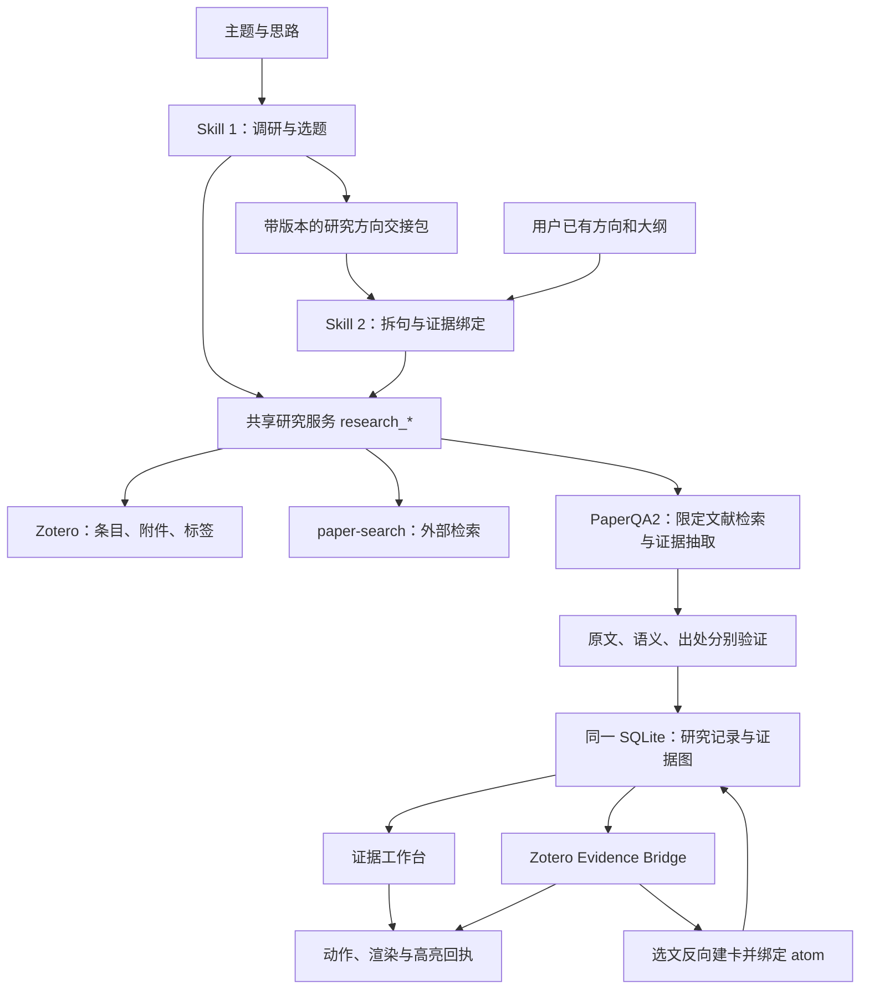

# 两个科研 Skill 与共享工具链：审核方案 v1

日期：2026-11-08。状态：**设计待审核，未安装 Skill、未改业务代码、未向文库写入数据**。

## 1. 建议批准的总体设计

提供两个独立 Skill，共用当前 SearchTools / Zotero / paper-search / PaperQA2 后端：

| Skill | 输入 | 主要工作 | 交付 |
| --- | --- | --- | --- |
| `paper-direction-discovery`（文献调研与研究选题） | 思路、主题，以及已有的资源约束 | 广泛发现、分层阅读摘要/结论/实验、建立可比实验矩阵、从证据推导候选方向 | 默认 3 个有依据的方向、各自大纲和实验方案、来源与缺口清单 |
| `paper-atomic-evidence`（论点方法拆解与证据绑定） | 已确定的方向、大纲、实验设计 | 拆分待写句子和方法步骤，逐项检索、语义核验、段落定位并绑定证据 | 句子—原子命题—证据图、可引用句子、证据卡和双端跳转高亮 |

两个审核版 Skill 正文在 [skills/](skills/)；[TOOLS.md](TOOLS.md) 定义工具与数据契约；[ACCEPTANCE.md](ACCEPTANCE.md) 定义验收。

设计原则：技能负责研究决策与执行顺序；可重复的检索、解析、校验、持久化和跳转由工具完成。复用现有后端，新增一组研究编排能力；不额外维护第二套证据库或第三个阅读器。

## 2. 已核查的现状与缺口

核查依据为本仓库代码及当前会话暴露的 MCP 清单。本轮只做静态核查，历史验收记录不等于本轮重新实测。

| 组件 | 已存在的基础 | 本方案需要的改进 |
| --- | --- | --- |
| Zotero MCP | `zotero_search_items`（参数 `q`）、`zotero_list_tags`、`zotero_list_collections`、`zotero_get_item`、`zotero_get_item_fulltext`、附件读写 | 建立跨标题/标签/摘要的中英检索与去重层；保留 library 标识；现有写入授权机制继续生效 |
| paper-search MCP | `search_papers`、arXiv / Semantic / OpenAlex / Crossref 等检索与部分下载接口 | 按实际平台参数适配分页/时间条件；统一元数据、来源与错误；没有能力的平台显式报告限制 |
| `searchtools/acquire.py` | DOI/arXiv 解析、候选导入、开放 PDF 获取 | 版本族去重、入库幂等、缺附件重试、批次断点、逐项失败结果 |
| `searchtools/mcp_server.py` | 当前会话暴露 12 个核心工具，包括 scope、coverage、gather、verify、cards、job | 现有若干响应为 Markdown；增加结构化数据、分页和能力发现；明确 scope，禁止拼错 ID 后默认选最近项目 |
| `searchtools/atomic.py` | 对检索上下文抽取一个 claim + 连续原文 quote，逐字回验 | 缺少写作前的需求侧句子/方法拆解；增加命题图、限制条件与反证检索 |
| `coverage_check` | 关键词/向量命中与最多 4 个子问题的启发式拆分 | 分开记录主题覆盖、阅读完成、证据支撑；不能用相似度判定学术上充分 |
| `verify_claim` | 启动问答，再根据回答关键词与卡片分数推断 verdict | 改成逐条关系判定与条件对齐；避免“未发现反驳”含反驳词就被判反驳，以及高分即支持 |
| `searchtools/locate.py` | 完整 quote、PDF 哈希、版面段 ID、字符偏移、跨页 spans、rects；重复摘录拒绝唯一定位 | 提取段落索引；源锚点辅助消歧；章节/语义段与版面块分开；复杂表格/OCR单列 |
| `core.py` / `server.py` / Evidence Bridge | 卡片存储、打开动作和回执、真实 Reader 选文反向建卡 | 暴露结构化定位/打开/动作状态 MCP；新增 atom 绑定和批量检索质量状态 |
| DeepTutor 模型事件 | `model_events.py` 已有 client/session/revision 状态 | 将同一模型上下文传入新增 MCP 任务；记录任务实际使用的 revision；防止跨会话串用 |

旧 `evidence-based-writing` 面向成稿与引用，保留为后续写作入口。它的“2～4 个问题”、高分直接复用、页码深链、自动 Word 导出等指令不直接套入本次设计。旧文档是待评估材料，本次用户请求决定两个新 Skill 的范围。

## 3. 共享架构

MCP 名称采用 `research_*` 与 `cards_*`；内部模块先按职责拆分，工具数不与模块数绑定。具体模块及接口见 TOOLS。

## 4. Skill 1：从主题到可执行的研究方向

### 4.1 研究范围与检索

1. 将主题展开为任务/系统、方法族、数据集或环境、评价维度、资源约束；未知约束写为假设，不把假设当成用户要求。
2. 先检索 Zotero：标题、已有标签、分类、中英文术语与缩写分别查找后取并集。标签是线索，不能作为唯一筛选门槛。
3. 记录纳入与排除标准、完整检索式、源、时间、排序、平台截断和失败。保留相关的反例与负结果。
4. 本地文献若缺少关键方法、近期工作、基线或实验结果，调用 paper-search 定向补缺；综述用于建立图谱，实验事实回到原始研究。
5. 去重分两层：DOI/arXiv/精确元数据识别同一条目；预印本和正式版组成 version family。标明真正采用的版本，不把一个实验算成多项独立证据。
6. 使用既有入库工具，每批最多 20 篇。用户已授权该课题自动补库时直接分批导入；否则候选暂存等待一次批次授权。当前仅设计，不执行入库。

### 4.2 大量阅读采用逐级深入

下列是可调默认预算，不是质量阈值，也不是必须凑满的篇数：

| 层级 | 默认规模 | 阅读与记录 | 可用于什么 |
| --- | --- | --- | --- |
| L0 发现 | 最多 300 条去重候选 | 标题、元数据、相关性与排除理由 | 筛选，不称为已读全文 |
| L1 摘要 | 约 60～100 篇 | 摘要、任务、方法、主要声称、全文可达性 | 主题地图、候选方法；不能验证具体实验 |
| L2 定向阅读 | 约 20～40 篇 | 结论、实验设置、结果、限制、相关表图 | 建立对比矩阵；缺章节显式标记 |
| L3 核心核验 | 约 8～15 篇 | 每个方向的直接依据、关键实验、消融与最近竞争方案 | 为核心推导创建可定位证据卡 |

必须逐篇保存 `sections_read`、缺失章节与证据定位；批量检索返回“100 篇”不能报告“精读了 100 篇”。分批完成并可断点恢复，避免所有全文同时塞入上下文。方向来源文章的关键实验须升级到 L3，不能仅据摘要拼出方向。

### 4.3 实验对比矩阵

每项实验一行，字段至少含论文版本、任务/数据划分、方法、训练与评估预算、基线、指标定义与方向、数值/单位、误差与种子数（原文未报则留空）、消融、运行条件、表/图/章节锚点、证据卡。

仅在任务、划分、指标、预算、硬件等可比时横向排序。不可比时分组并说明差异，不跨硬件或数据集直接计算“提升百分比”。结论性段落和实验表格保留不同来源身份；表格的行列标题、脚注和单位必须与数值一起读取。

### 4.4 从差距到候选方向

逐个构造“已验证观察 → 条件或局限 → 研究者推导 → 可证伪假设 → 实验”的链条。区分作者明确提出的局限、agent 跨论文推导与用户原始设想。

每个方向交付：

- 临时题目、研究问题、具体创新假设与适用条件。
- 来源表：哪篇文章、哪个实验/消融/结论、锚点、证据卡、如何导出这项改进。
- 最近邻工作差异表与定向重复性检索；只能声明“在本次检索范围内尚未发现”，不能保证无人做过。
- 方法模块、拟修改的组件、输入输出、必要假设；哪些已被文献验证，哪些仍是新设计。
- 论文大纲：引言、相关工作、方法、实验、讨论；每节的核心问题和待补证据。
- 实验：明确研究问题、基线、数据/环境、变量、对照、消融、指标、统计方案、成本、成功与失败判据。
- 最小可行实验、预期风险与失败后的替代路径；预期结果标为假设，不填写虚构性能。
- 推荐顺序及理由：证据、差异、可执行性、成本分别呈现，不用一个伪精确总分盖过缺口。

默认给出 3 个方向；若只能支持 1～2 个，照实给出，其余列为待验证想法。报告交付 Markdown、实验矩阵 CSV、结构化交接 JSON；用户需要 Word 时再导出。

### 4.5 何时停止补充

按主题维度检查，而非只看总篇数。关键方法/基线/结果/反证维度均有阅读记录；每个正式候选方向的关键来源均有实验依据和直接锚点；默认两轮定向补缺无新增有效核心工作时可结束，并披露剩余缺口。达到费用、时间或条数预算时返回受限报告和续跑点，不伪称充分。

## 5. Skill 2：从大纲到可引用的段落证据

### 5.1 先拆需要什么证据

保留原大纲位置与原句，生成稳定 ID 和 revision。每个 atom 是一句可单独核验的陈述或一个方法步骤，字段含系统/对象、条件、关系或操作、比较对象、指标/结果、限定范围、所需证据类型。

示例仅说明拆分规则，不是论文事实：

> “方法 A 降低控制延迟并提高能效，因此适用于真实机器人。”

拆为 A1“在条件 C 下，A 相比 B 降低控制延迟”、A2“在条件 C 下，A 相比 B 改善指标 E”、A3“该结果可推广至真实机器人”。A3 需要真机实验或明确的迁移条件，不能从 A1/A2 自动推得；原句缺 C/B/E 时标记待明确，不能自动补成文献已有事实。

方法拆为动机、算法来源、机制/公式、参数选择、实现步骤和验证假设。atom 类型区分 `background_fact`、`reported_result`、`method_origin`、`method_step`、`design_choice`、`hypothesis`；原创设计不强行伪装成已有方法。

### 5.2 按 atom 检索并锁定版本范围

每个 atom 生成主题/方法/指标/反证查询；先标题、标签与摘要筛选 Zotero，再按缺口 paper-search 补充、导入、等待附件和索引。冻结显式 scope 的文献版本和 PDF 哈希快照，再调用 PaperQA2。

Skill 1 的交接包可复用，Skill 2 也能接受独立输入。不能将“没有索引结果”解释为“没有相关论文”；分别报告文库不足、PDF 不可得、索引失败和检索不足。

### 5.3 证据匹配与验证

1. PaperQA2 按 atom 的查询和候选子集检索，结合关键词/向量与章节信息召回；对支持和反驳分别检索。先单项重排，再批量执行，避免一条笼统问题只返回少数热门论文。
2. 从候选段落抽出独立源命题和连续原文 quote，保存前后语境。一个 atom 可有多个独立支持卡、限定卡或反驳卡；一张卡可复用到多个 atom，但关系按每次绑定分别核验。
3. 三类核验分开：原文逐字回验、出处/段落坐标核验、语义蕴含及条件核验。只有完整 quote 在正确附件找到，不能证明它支持目标句。
4. 对照对象、条件、指标、单位、方向、数值、统计和因果强度逐项比对；“提出的方法”与“测得结果”分开判定。结构化输出 `supports / contradicts / qualifies / insufficient` 与理由。
5. 对表图证据先读完整行列/图例/脚注和说明段落。图像曲线只有视觉估读时标为估读；不能由模型生成原文不存在的段落引语。
6. 条件不足、重复位置、扫描文字或公式无法核验时，保持待核验并给出补救动作。拒绝虚假高亮，允许有标签的页级浏览。

### 5.4 证据图与引用

持久化 `outline_node → sentence → atom → binding → card → source spans`。binding 单独记录关系、限制条件、语义核验及使用目的；卡片保留论文事实与原文，不被新的目标句覆盖。

正式支持覆盖率 = 至少有一条有效 `supports` 绑定的需外部支撑 atom 数 / 需外部支撑 atom 总数。`qualifies` 单列；修改目标句接受其限制并重新核验前不计入完整支持。原创假设单独显示，不算已验证。未找到证据的句子交付为缺口，不消失、不冒充已获支持。

输出句子表：原句、推荐句、atom ID、类型、卡片、关系、核验状态、段落、引用、双端入口。数值句子必须绑定对应实验，而不是只引用方法论文。

### 5.5 工作台与 Zotero 闭环

- 工作台：按大纲/atom 浏览；展示支持、限定、反驳、缺口和原文上下文；按 scope 与版本过滤；所有状态从后端同一数据源读取。
- Zotero 面板：沿用当前条目卡片区，补充所属 atom、大纲位置、绑定关系和核验状态；跨项目卡片按 scope 区分。
- 点“原文高亮”：检查原 PDF 哈希和出处，再提交动作；仅有排队回执显示“等待 Zotero”，收到页渲染与批注载入回执才显示“已定位”；失败显示可操作原因。
- 多段/跨页：逐 span 建临时批注并保留关联；`#evidence-temp` 标识现有机制延续，清理增加桥接来源/卡片标识校验，保留普通用户批注。
- 反向建卡：真实选区回验后可选择已有 atom 或进入“待整理”，不根据最近项目自动猜绑定；仍需语义核验后才进入正式支持覆盖率。
- 引用与笔记使用同一 card/atom ID 和版本；笔记主入口指向证据协议，页级协议仅作降级入口并标识不能保证高亮。

## 6. 工具复用与开源引入决策

| 能力 | 决策 | 原因与边界 |
| --- | --- | --- |
| 文库及附件管理 | 复用 Zotero MCP 与既有导入层 | 所有写入走 API/插件，不直接写 Zotero SQLite |
| 外部发现 | 复用 paper-search，加适配层 | 先解决分页、去重、重试和日志，不重新实现全部平台 |
| 语义检索与证据抽取 | 继续复用 PaperQA2 | 本项目负责命题绑定和定位；上游 RAG 的返回不能直接当精确引文认证。[上游](https://github.com/Future-House/paper-qa) |
| 字符与坐标 | 继续复用 PyMuPDF | 其结构化文本含块、行、span、字符等层级，适合现有映射；语义段不能等同版面块。[官方说明](https://pymupdf.readthedocs.io/en/latest/app1.html) |
| 章节结构 | 先做现有文本层与目录/标题规则；GROBID 作为可插拔候选 | GROBID 提供学术文档结构抽取；只有样本文献显示规则方案不足时再做隔离部署试验，结果须回映原 PDF。[官方项目](https://github.com/grobidOrg/grobid) |
| 扫描件 | OCRmyPDF 作为可选 OCR 管线 | 可添加可搜索文字层；OCR 派生附件保留原件，变换映射未验收前不承诺能在原件精确高亮。[官方项目](https://github.com/ocrmypdf/OCRmyPDF) |

本轮未拉取、安装或启用新服务。后续引入开源依赖时固定版本/提交、记录许可证与运行资源，并以中文、多栏和表格样本决定是否采用；不能以换解析器替代出处回验。

## 7. 实施顺序与每阶段交付

| 阶段 | 内容与主要文件 | 交付 / 退出条件 |
| --- | --- | --- |
| P0 契约与基线 | 本设计、能力探测、已有证据卡/插件/模型同步基线 | 明确真实可调用接口；冻结旧行为验收样本 |
| P1 共享研究底座 | `core.py` 迁移；新 `research_store.py`、`research_search.py`；改 `acquire.py` | run/scope 快照、来源版本去重、检索日志、幂等补库、断点续跑 |
| P2 解析与阅读矩阵 | 新 `research_reading.py`；改 `locate.py`、`engine_worker.py` | 持久段落锚点、章节阅读账本、实验行及可比性；复杂表/OCR明确降级 |
| P3 Skill 1 | 新 `research_directions.py`、研究 MCP 接口、Skill 1 正式包 | 用真实主题生成方向包；每个核心改进可追到具体实验；完成选题验收 |
| P4 Skill 2 | 扩展 `atomic.py`，新 `research_binding.py`；改 `verify_claim` 与卡片接口 | 需求侧原子图、批量匹配、结构化判定、正反证、三层验证和覆盖缺口 |
| P5 双端溯源 | 改 `server.py`、`static/workbench.js/html/css`、`zotero-plugin/bootstrap.js` | atom 列表/绑定、打开 MCP、真实 Reader 高亮回执、反向建卡回绑 |
| P6 联调与安装 | 两个正式 Skill；旧写作 skill 路由更新；验收报告与发布包 | 全链路真实文库任务通过；备份/迁移/回滚文档齐备；再安装到发现目录 |

先实现最小纵向链路：一个主题 → 两篇可比实验 → 一个候选方向 → 三个 atom → 正/反证卡 → 双端高亮 → 选文回绑。再扩到大量阅读和完整规模，避免堆出无法闭环的工具。

进度通过 jobs/events 展示，长任务返回 job ID，支持取消/重试/恢复。每批提交检查当前模型 revision；已运行任务记录启动时模型，新任务用最新已确认模型；不可混写结果。嵌入模型变化使向量索引单独失效，已有原文坐标仍按 PDF/解析版本核验。

## 8. 迁移、兼容与交付

- 新数据表采用增量迁移；迁移前备份 SearchTools 数据，不重写 Zotero 数据库。
- 原有卡片 ID 与协议保留；补校验后再标为可引用，无法定位的卡不自动提升可信度。
- 既有 MCP 默认响应与签名尽量兼容，通过可选 `response_format` 及新增工具扩展；同步工具描述中的 v2/v3 过时说明。
- 新 Skill 审核稿放在 docs 中，不进入自动发现目录。批准后再安装至项目 `.agents/skills/`；旧 skill 只路由到合适阶段，不再给新技能强制附带 Word 成稿步骤。
- 新增依赖保持可选，默认链路不依赖 GROBID/OCR；回滚代码时同时恢复迁移前数据副本，不能让旧代码误读新 schema。
- 验收数据位于独立 scope；真实文献原附件保留。引用交付只收录明确采用且核验状态合格的卡片。

## 9. 本版待你审核的选择

建议按以下默认值实施，均可调整：

1. 两个独立技能 + 一套共享后端；选题结果可交接，也允许单独使用第二个技能。
2. 正式输出默认 3 个方向；质量不足时减少数量；阅读规模按预算自适应。
3. 默认仅获取可访问的开放全文；不可得条目保留元数据与缺口，不称为已读实验。
4. 课题明确授权自动补库后，每批 ≤20 篇持续导入，不在每批重复提问；保留逐项日志。
5. 第一版覆盖文字 PDF 的章节、段落、正文实验与可可靠解析的表格；复杂表图/OCR作为扩展阶段，未核验必须显式显示。
6. 按 ACCEPTANCE 的真实文库闭环验收后再正式安装，保留旧流程可回滚。

本轮交付完成标准是设计与两份 Skill 正文可供审核；业务实现、外部入库、开源部署及运行验收安排在审核通过后。
