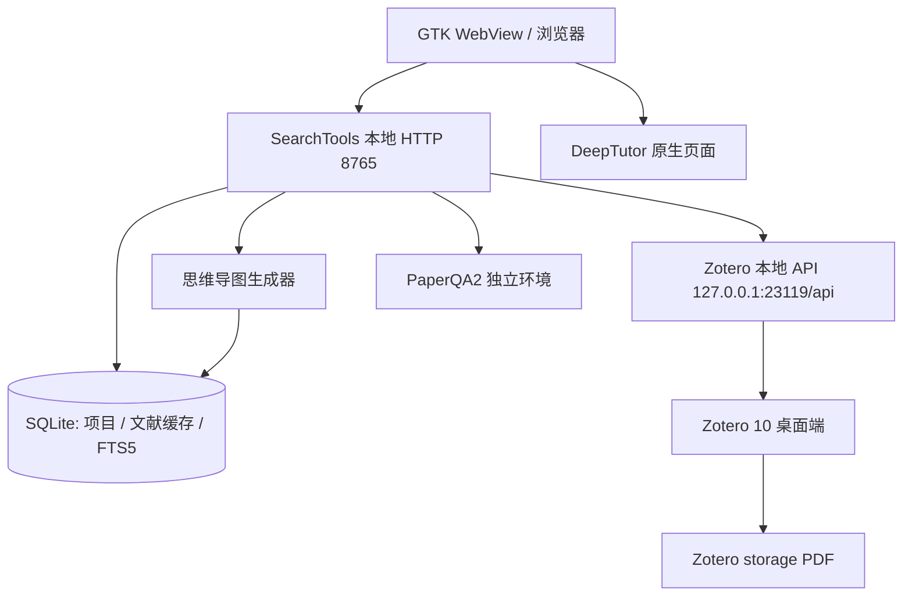

# 开源本地文献管理工具选型与 SearchTools 集成方案

> 调研日期：2026-11-05。目标：在不引入云服务、不把文献上传给第三方的前提下，为 SearchTools 增加一套可分类、可全文检索、能提取思维导图、并且能被程序稳定调用的文献管理层。
>
> **结论先行：没有一款成熟开源工具能同时把“文献管理 + 全文检索 + 原生脑图”都做好。** 最稳妥的组合是 **Zotero 10 作为文献事实来源**，**SearchTools 自己从 Zotero 的标注、笔记和分类生成思维导图**。Zotero 负责它最擅长的元数据、PDF、标注、分类和全文索引；SearchTools 负责项目范围、PaperQA2 任务和脑图呈现。这样既不重复造文献库，也不被某个脑图插件的成熟度绑住。

---

## 1. 需求拆解

| 需求 | 可验收的标准 | 为什么不能只看宣传页 |
|---|---|---|
| 本地优先 | 断网可用；文献与笔记不经过第三方服务器 | “支持离线”不等于“默认本地”，有的工具首次启动仍要登录 |
| 开源许可 | 代码可获取、许可允许本地集成与分发 | 免费软件不等于开源；插件也可能有收费功能 |
| 分门别类 | 层级分类、多分类归属、标签、智能筛选/保存搜索 | 只有文件夹不够：同一篇论文通常属于多个课题 |
| 快速检索 | 元数据 + 笔记 + PDF 全文；中英文；结果可回到原文 | 只搜标题不算全文检索；中文分词是常见短板 |
| 思维导图 | 从标注/笔记生成层级结构，保留页码和出处 | “能画图”不等于“能从文献自动提取”，更不等于可追溯 |
| 可集成 | 稳定的本地 API/CLI；稳定 ID；增量同步；不锁数据库 | 直接读 SQLite 容易被版本升级和写锁破坏 |
| 可维护 | 近一年有提交；有发布节奏；社区和插件生态 | 停更工具的风险会随时间放大 |

---

## 2. 候选工具对比

| 工具（许可） | 本地/离线 | 分类能力 | 快速检索 | 思维导图 | 可集成性 | 维护状态 | 结论 |
|---|---|---|---|---|---|---|---|
| **Zotero 10**（AGPL-3.0） | 完全本地；可只同步元数据或完全离线 | 层级 Collection、多分类、标签、保存搜索；Zotero 10 高级搜索支持嵌套条件、标注颜色/类型/作者、按条目/附件/标注/笔记层级返回 | PDF/EPUB/HTML/文本全文索引；“Everything”搜索；Zotero 10 改进中日韩短语与重音不敏感检索；本地 API `qmode=everything` | 原生无；Better Notes 可导出 FreeMind `.mm`；标注/笔记可自建脑图管线 | **本地 API v3**：读无需鉴权，Zotero 10+ 可写；有文件路径、全文、保存搜索端点 | 活跃；10.0.7（2026-10-29） | **主推荐：文献事实来源** |
| **Paperlib 3.1**（GPL-3.0） | 本地；可选云同步 | 标签、文件夹、智能筛选 | 全文检索；扩展可做语义检索 | 无 | 扩展 API（PLAPI）；无稳定本地 HTTP API | 活跃但作者公开寻找共同维护者；3.1.12（2025-09） | 备选：元数据抓取/轻量整理 |
| **JabRef 5.15 / 6.0 beta**（MIT） | 本地；BibTeX 文件 | 层级分组、标签、关键词分组 | Lucene 全文检索（含链接 PDF） | 无 | 5.x 无 HTTP 读 API；6.x 有 `jabsrv` REST/WebSocket（beta）；JabKit CLI | 活跃；6.0 beta（2026-09） | 备选：LaTeX/BibTeX 工作流 |
| **SiYuan 3.8**（AGPL-3.0） | 本地/自托管 | 文档树、标签、块引用、SQL 查询 | 全文检索、资源内容检索、语义检索（CLI） | 插件 `simplemindmap` 支持文档树/大纲转脑图 | HTTP API、CLI、SQL | 活跃；3.8.9（2026-10） | 可选：中文笔记/写作层，不是文献库 |
| **Obsidian（闭源，个人免费）/ Logseq（AGPL-3.0）** | 本地 Markdown | 文件夹、标签、双链 | 全文/插件检索 | Markmap/Canvas/插件 | 第三方本地 REST API 或 HTTP API | 活跃 | 只适合作为笔记层 |
| **Docear** | 本地 Java | BibTeX + 脑图 + PDF | 有，但老旧 | **原生脑图** | 无现代 API | **2017–2018 起停止开发** | 不推荐：经典但已停更 |
| Calibre / Paperless-ngx（GPL-3.0） | 本地 | 标签/文档类型 | 全文/OCR | 无 | 有 API | 活跃 | 不适配学术文献元数据与引用 |

### 2.1 为什么不是 Docear

Docear 几乎是“文献管理 + 思维导图”这个需求的标准历史答案：BibTeX、PDF 标注、脑图在同一个桌面应用里。但它的开发在 2017–2018 年停止，在线服务也已下线。用它做新项目的基础设施，风险高于收益；如果只是怀念它的脑图交互，应该把脑图能力做进 SearchTools，而不是把文献库迁到一个停更的 Java 应用。

### 2.2 为什么不是 Paperlib

Paperlib 的定位很清晰：更现代的 UI、更强的会议论文元数据抓取、标签/文件夹/智能筛选、全文检索，扩展还能做语义搜索和 LLM 总结。它对“机器人/机器学习会议论文没有 DOI、元数据难抓”的场景很有吸引力。

但它不适合作为 SearchTools 的**主干**：

- 没有稳定的本地 HTTP API；扩展 API 运行在 Electron 渲染进程里，SearchTools 的 Python 标准库后端无法直接调用。
- 没有原生脑图；脑图仍要另做。
- 作者公开寻找共同维护者，长期维护存在不确定性。

更合适的用法：把 Paperlib 当作“发现和清洗元数据”的旁路工具，整理好后导出 BibTeX/RIS 给 Zotero，而不是让 SearchTools 直接依赖它。

### 2.3 为什么不是 JabRef

JabRef 是 BibTeX/BibLaTeX 工作流里最可靠的开源选择：MIT 许可、层级分组、标签、Lucene 全文检索、JabKit CLI、与 LaTeX 编辑器协作。6.0 beta 也在推进。

但它面向的是“管理 .bib 文件”，不是“管理一个可被程序查询的本地文献服务”：

- 5.15 没有 HTTP 读 API；6.x 开始提供 `jabsrv` 的 REST/WebSocket 接口，但 6.0 仍是 beta，接口稳定性和安全边界（例如无鉴权的本地监听）需要评估。
- 没有脑图。
- 对 PDF 标注、笔记、阅读状态的管理弱于 Zotero。

如果 SearchTools 未来要支持“写论文时插入引用”，JabRef/Better BibTeX 是很好的补充；日常检索和脑图不应以它为主。

### 2.4 为什么不是 SiYuan

SiYuan 是很强的本地知识库：块级引用、SQL 查询、HTTP API/CLI、PDF 标注链接、中文界面，社区插件 `simplemindmap` 可以把文档树/大纲转成脑图。

但它不是文献管理器：没有 DOI/arXiv/CSL 驱动的元数据工作流，没有 Zotero 那样的条目类型和引用样式，也没有“从 PDF 标注自动生成条目笔记”的成熟链路。把它当“笔记/写作层”可以，但不建议再建一套文献库，否则会出现两份元数据、两套附件、两个真相来源。

---

## 3. 为什么主推荐 Zotero 10

### 3.1 分类：Collection、标签、保存搜索，正好覆盖“分门别类”

- **Collection 是层级分类，且一篇文献可以同时属于多个 Collection**。这比“一个文件夹只能放一篇”的模型更适合跨课题文献。
- **标签**适合横向维度：方法、数据集、读没读过、可复现性、写作状态。
- **保存搜索（Saved Search）是动态分类**：例如“2024 年以后 + 含 ‘terrain’ + 有 PDF + 有黄色标注”。Zotero 10 的高级搜索支持嵌套条件组，并可以把结果层级选为“顶层条目 / 附件 / 标注 / 笔记”，还新增了标注类型、颜色、作者等条件。
- 对 SearchTools 来说，这意味着“项目范围”可以直接绑定一个 Collection、一个标签或一个保存搜索，而不必在 SearchTools 里重新维护一套分类。

> 关键点：Zotero 的 Collection 是“归属关系”，不是物理文件夹。同一篇论文可以同时在“四足机器人”和“地形泛化”两个 Collection 里，附件只存一份。SearchTools 应该沿用这个模型，而不是复制文件。

### 3.2 检索：全文索引 + 本地 API，快且可编程

Zotero 会为 PDF、EPUB、HTML 和纯文本建立全文索引；快速搜索的“Everything”模式会覆盖所有字段、标签、笔记和 PDF 索引文本。Zotero 10 还改进了：

- 中日韩（CJK）短语检索；
- 重音和排版字符不敏感；
- 全文检索速度；
- 高级搜索的结果层级与标注条件。

对程序集成更重要的是**本地 API**：

- 基础地址 `http://localhost:23119/api/`；
- 读请求无需鉴权，离线可用，无速率限制，默认不分页；
- `q` + `qmode=everything` 可以按全文内容搜索；
- `<prefix>/searches/<searchKey>/items` 可以直接执行 Zotero 的保存搜索（Web API 没有这个能力）；
- `<prefix>/items/<itemKey>/fulltext` 返回附件全文；
- `<prefix>/items/<itemKey>/file/view/url` 返回附件的 `file://` 路径；
- Zotero 10+ 支持写请求，可以在用户授权后创建笔记、分类、标签。

这意味着 SearchTools 不需要解析 Zotero 的 SQLite，也不需要抓网页；用 Python 标准库 `urllib` 就能完成只读集成。

### 3.3 思维导图：Zotero 不原生做，但它的数据模型最适合做

Zotero 里和脑图有关的数据有三类：

1. **PDF 标注（annotation）**：高亮、下划线、笔记、区域标注、墨水标注。每条标注是附件的子条目，带有：
   - `annotationText`：高亮文本；
   - `annotationComment`：自己的批注；
   - `annotationColor`：颜色（如 `#ffd400`）；
   - `annotationPageLabel`：印刷页码；
   - `annotationSortIndex`：页内排序；
   - `annotationPosition`：位置 JSON；其中 `pageIndex` 从 0 开始，和印刷页码不是一回事，展示时应优先用 `annotationPageLabel`；
   - `tags`：标注标签。
2. **笔记（note）**：HTML 富文本，支持标题层级、列表、链接、引用。Zotero 可以“从所有标注创建笔记”，Better Notes 还能用模板批量生成结构化笔记。
3. **分类与标签**：提供脑图的上层结构。

所以，“提取思维导图”不应该理解成“让 AI 看一眼 PDF 画一张图”，而应该是：

```text
Collection / 保存搜索 / 选中论文
        │
        ├─ 论文元数据（标题、年份、作者、DOI）
        ├─ PDF 标注（原文 + 批注 + 页码 + 颜色 + 标签）
        ├─ 笔记（标题层级、列表、链接）
        └─ 标签 / 分类
                │
                ▼
        确定性大纲（可追溯）
                │
        ┌───────┼────────┐
        ▼       ▼        ▼
    Markdown  FreeMind   SearchTools
    /Markmap   .mm       SVG 脑图
```

**Better Notes 的定位**：它能把笔记导出为 FreeMind `.mm`，支持笔记双链、关系图、模板、Markdown 双向同步。它是很好的“人工整理”工具，但 `.mm` 导出是手动操作，不适合作为 SearchTools 的自动集成接口。SearchTools 应该直接读 Zotero 的标注/笔记数据，自己生成大纲；Better Notes 作为可选的手工增强。当前 v3.3.3 的插件 manifest 声明兼容 Zotero 8–10.x。

### 3.4 许可与集成边界

Zotero 是 AGPL-3.0。SearchTools 通过本地 HTTP API 调用 Zotero，属于两个独立程序之间的接口调用，不把 Zotero 代码链接进 SearchTools；SearchTools 自有代码仍是 MIT。需要注意：

- 不要把 Zotero 的源代码复制进 SearchTools；
- 如果安装器要“打包分发 Zotero”，需要遵守 AGPL 的源码提供等义务；更简单的做法是让用户自行安装 Zotero；
- Better Notes 也是 AGPL，作为独立插件使用没有问题，但不要复制其代码。

---

### 3.5 中文文献的元数据：Zotero 的短板，需要单独补

Zotero 原生主要通过 DOI、arXiv ID 或 PDF 内嵌元数据来检索；中文 PDF/CAJ 往往没有这些信息，所以自带“检索元数据”大概率失败，或者识别成一个英文条目。建议在 Zotero 侧解决，而不是让 SearchTools 去猜：

- **装 Jasminum（茉莉花）插件**：按文件名从知网抓取元数据；兼容 Zotero 9/10/11；文件名建议 `标题_第一作者.pdf`，也可用“智能识别”。见 [茉莉花插件说明](https://zotero-chinese.com/user-guide/plugins/jasminum)。
- **知网/万方/维普导出 EndNote/RIS，再导入 Zotero**：老论文、学位论文、文件名不规范时最稳；导出只含题录，PDF 需要手动拖到条目上。见 [中文文献附件自动识别](https://zotero-chinese.com/user-guide/add-items#中文文献附件自动识别)。
- **中文姓名**：用茉莉花拆分/合并作者姓和名；条目语言设为 `zh-CN`；引用样式用中文社区的 GB/T 7714 样式。
- **学位论文**：Zotero 条目类型要选 **Thesis**，填写 `thesisType`（硕士/博士）、`university`、`place`、`numPages`；Thesis 类型没有独立的“导师”字段，导师可放在 `Extra` 里（如 `导师: 申富饶 教授`）。知网/万方导出后经常是期刊或报告类型，导入后要手动改成 Thesis。
- **CAJ/扫描版**：Zotero 不能直接读 CAJ，需要先转 PDF（[caj2pdf](https://zotero-chinese.com/user-guide/faqs/caj2pdf)）；扫描版需要先 OCR，否则全文检索和标注都受限。

边界：SearchTools 不负责“补元数据”，它只读 Zotero 已经整理好的条目。中文元数据质量在 Zotero 侧解决，接入层只做缓存、检索和项目范围。

## 4. SearchTools 集成架构

### 4.1 总体结构



原则：

1. **Zotero 是文献事实来源**：元数据、PDF、标注、笔记、分类都在 Zotero。
2. **SearchTools 是索引和工作流层**：缓存元数据、提供项目范围、生成脑图、调度 PaperQA2。
3. **不直接写 Zotero SQLite**：Zotero 运行时数据库可能被锁；用本地 API。
4. **不复制整库 PDF**：默认只记录附件路径；任务入队时再把所需文件冻结到任务快照。
5. **脑图是“视图”，不是新的事实来源**：每个节点尽量带 `itemKey`、页码、`annotationKey`，可回到原文。

### 4.2 连接与同步

**启动探测**

```http
GET http://127.0.0.1:23119/api/
```

响应头里读取：

- `X-Zotero-Version`：客户端版本（本地实测 10.0.7）；
- `X-Zotero-Connector-API-Version`：连接器 API 版本；
- `Zotero-API-Version`：本地 API 版本（本地固定 3）；
- `Zotero-Schema-Version`：schema 版本；
- `Zotero-Server-ID`：Zotero 10+ 的实例 ID。

如果返回 `403`，说明用户没有开启“允许其他应用与本机 Zotero 通信”。界面应直接给出路径：

> Zotero → 编辑/设置 → 高级 → 勾选“Allow other applications on this computer to communicate with Zotero”。

**同步策略**

- 首次：拉取 `collections`、`items/top`、`items?itemType=attachment`、`items?itemType=note`、`items?itemType=annotation`（若版本支持；否则按父条目 children 递归）。
- 增量：用 `?since=<Last-Modified-Version>` 拉取变化对象；保存 `server_id` + `last_version`。
- 如果 `server_id` 变化：清空缓存，全量重建。Zotero 10+ 的本地版本与 Web API 版本无关，不能混用。
- 删除：Zotero 的增量结果可能带 `deleted` 标记；本地缓存对应删除，避免“幽灵条目”。
- 全文：默认不落库。需要搜索片段时调用 `/items/<attachmentKey>/fulltext`，按需缓存；缓存要带版本，附件变化后失效。
- 附件路径：每次同步通过 `/items/<attachmentKey>/file/view/url` 重新解析，不长期保存可能失效的绝对路径；或者保存后在使用前校验存在性。

**为什么不用直接读 SQLite**

- Zotero 运行时会对 `zotero.sqlite` 加锁，直接读可能拿到不一致状态或触发 `database is locked`；
- Zotero 的表结构会随版本变化；
- 本地 API 已经封装了版本、权限、文件路径和全文，维护成本更低。

### 4.3 数据模型

在现有 `workspace.sqlite3` 中新增表（保持标准库 `sqlite3`，不引入 ORM）：

```sql
-- Zotero 连接与增量状态
CREATE TABLE IF NOT EXISTS zotero_state(
  server_id TEXT PRIMARY KEY,
  zotero_version TEXT,
  last_version INTEGER DEFAULT 0,
  synced REAL
);

-- 分类（Collection 可嵌套）
CREATE TABLE IF NOT EXISTS zotero_collections(
  key TEXT PRIMARY KEY,
  name TEXT NOT NULL,
  parent TEXT,
  version INTEGER
);

-- 顶层条目（论文、书籍、报告等）
CREATE TABLE IF NOT EXISTS zotero_items(
  key TEXT PRIMARY KEY,
  item_type TEXT,
  title TEXT,
  year TEXT,
  creators TEXT,          -- JSON
  abstract TEXT,
  doi TEXT,
  url TEXT,
  tags TEXT,              -- JSON: ["tag1","tag2"]
  collections TEXT,       -- JSON: ["KEY1","KEY2"]
  date_added TEXT,
  date_modified TEXT,
  version INTEGER,
  extra TEXT
);

-- 附件（PDF/EPUB/HTML）
CREATE TABLE IF NOT EXISTS zotero_attachments(
  key TEXT PRIMARY KEY,
  parent TEXT,
  filename TEXT,
  content_type TEXT,
  path TEXT,              -- 最近一次解析的 file:// 路径
  md5 TEXT,
  version INTEGER
);

-- 标注（高亮/下划线/笔记/区域）
CREATE TABLE IF NOT EXISTS zotero_annotations(
  key TEXT PRIMARY KEY,
  parent TEXT,            -- 顶层条目 key
  attachment TEXT,        -- 附件 key
  type TEXT,
  text TEXT,
  comment TEXT,
  color TEXT,
  page_label TEXT,
  sort_index TEXT,
  tags TEXT,              -- JSON
  position TEXT,          -- 原始 annotationPosition JSON
  version INTEGER
);

-- 笔记
CREATE TABLE IF NOT EXISTS zotero_notes(
  key TEXT PRIMARY KEY,
  parent TEXT,
  title TEXT,
  html TEXT,
  text TEXT,
  version INTEGER
);

-- 项目与 Zotero 范围的绑定
CREATE TABLE IF NOT EXISTS project_library(
  project TEXT NOT NULL,
  source_type TEXT NOT NULL,   -- collection | saved_search | tag | item
  source_key TEXT NOT NULL,
  created REAL,
  PRIMARY KEY(project, source_type, source_key)
);

-- 本地检索索引（trigram 对中英文子串都友好；1–2 字查询用 LIKE 兜底）
CREATE VIRTUAL TABLE IF NOT EXISTS library_fts USING fts5(
  kind,                    -- item | note | annotation
  key UNINDEXED,
  title,
  body,
  tokenize='trigram'
);
```

现有 `papers` 表建议增加三列（用 `PRAGMA table_info` 做幂等迁移）：

```sql
ALTER TABLE papers ADD COLUMN zotero_item TEXT;
ALTER TABLE papers ADD COLUMN zotero_attachment TEXT;
ALTER TABLE papers ADD COLUMN source_path TEXT;
```

这样一篇论文仍然只保存一份任务副本；`zotero_item`/`zotero_attachment` 用于回链和去重，`source_path` 记录来源路径。

### 4.4 项目范围与 PaperQA2 的衔接

SearchTools 现有模型是“项目 → 项目文献 → 任务快照”。接入 Zotero 后建议：

1. **绑定范围**：项目可以绑定一个 Collection（含子 Collection）、一个保存搜索、一个标签，或手动选择条目。
   - 注意：`/collections/<key>/items/top` 只返回直接归属该 Collection 的条目；要包含子 Collection，需要递归 `/collections/<key>/collections` 并在客户端合并。
2. **导入项目**：点击“从 Zotero 导入”时，把选中条目的附件解析为本地路径，计算 SHA-256，写入 `papers`；相同内容仍然去重。
3. **任务快照**：`enqueue` 时把所需 PDF 复制或硬链接到 `jobs/<id>/papers/`，保持现有“任务输入冻结”的保证。优先硬链接（同一文件系统、不占额外空间），失败再复制。
4. **索引失效**：记录附件的 `version`/`md5`；附件变化时提示重建该项目索引，不自动重建。
5. **标注和笔记**：PaperQA2 只读 PDF 文本，不读 Zotero 标注。若希望问答覆盖自己的批注，Additional 生成一份 `阅读笔记.md`（标注 + 批注 + 页码）加入项目文献，让 PaperQA2 也能检索到。注意在回答中区分“论文原文”和“我的批注”。

> 这一步很关键：不要把“Zotero 标注”误当成“PDF 全文”喂给 PaperQA2。标注是你自己的理解，不是论文原文；两者要分文件、分来源标记。

### 4.5 本地 API 映射表

| 需求 | 本地 API | 说明 |
|---|---|---|
| 探测/版本 | `GET /api/` | 读响应头；403 表示未开启本地 API |
| 分类树 | `GET /api/users/0/collections` | `data.parentCollection` 表示父级 |
| 顶层条目 | `GET /api/users/0/items/top` | 默认不含回收站 |
| 分类内条目 | `GET /api/users/0/collections/<key>/items/top` | 项目绑定 Collection 时使用 |
| 子项 | `GET /api/users/0/items/<key>/children` | 附件、笔记、标注 |
| 全库标注 | `GET /api/users/0/items?itemType=annotation` | 若版本不支持则按附件 children 拉取 |
| 全库笔记 | `GET /api/users/0/items?itemType=note` | 笔记正文在 `data.note` |
| 快速搜索 | `GET /api/users/0/items?q=<q>&qmode=everything` | `q` 目前是短语搜索；多词查询需拆分或走本地 FTS |
| 执行保存搜索 | `GET /api/users/0/searches/<key>/items` | 本地 API 独有；Web API 只返回搜索定义 |
| 附件全文 | `GET /api/users/0/items/<attachmentKey>/fulltext` | 返回 `content`、`indexedPages`、`totalPages` |
| 附件路径 | `GET /api/users/0/items/<attachmentKey>/file/view/url` | 返回纯文本 `file://` URL |
| 增量同步 | `GET /api/users/0/items?since=<version>` | 配合 `Last-Modified-Version` |
| 写笔记（可选） | `POST /api/users/0/items` | Zotero 10+；需要本地 API key 与 `Zotero-Server-ID` |
| 申请写权限 | `POST /api/local/authorize` | 弹出 Zotero 授权对话框；`Always Allow` 才可复用 |

**只读集成的请求头**：

```http
Accept: application/json
Zotero-API-Version: 3
```

**写请求额外需要**：

```http
Zotero-Server-ID: <serverID>
Zotero-API-Key: <localKey>
```

### 4.6 检索设计：两层检索，避免重复造轮子

建议做成两层，界面只给一个搜索框：

**第一层：Zotero 本地 API（新鲜、覆盖全文）**

- 用于“搜 PDF 全文”“搜刚改过的内容”。
- `qmode=everything` 覆盖标题、作者、标签、笔记、PDF 索引文本。
- 注意：`q` 目前只支持短语搜索。多词查询要么拆成多个请求再合并，要么走第二层。

**第二层：SearchTools FTS5（离线、可过滤、可排序）**

- 索引 `title`、`abstract`、`note.text`、`annotation.text/comment`、`tags`。
- 使用 `tokenize='trigram'`，对中文 3 字以上和英文子串都有效；中文 1–2 字查询用 `LIKE '%q%'` 兜底。
- 过滤条件：Collection、标签、年份、条目类型、是否有 PDF、标注颜色、是否有笔记。
- 排序：标题精确命中 > 标题前缀 > 摘要 > 标注/笔记 > 全文；再按年份/最近修改。

**为什么不把 PDF 全文全部灌进 SearchTools**

- 全文体积大，重复索引没有意义；
- Zotero 已经维护了全文索引，并且 Zotero 10 对 CJK 做了优化；
- 需要片段时再调用 `/fulltext`，按需缓存即可。

**中文检索的实测注意**

在 SQLite 3.37 上实测：`trigram` 对 3 个及以上汉字有效（如“机器人”），对 2 个汉字（如“地形”）不命中。因此：

- 2 字及以下：`LIKE '%关键词%'`；
- 3 字及以上：FTS5 `MATCH`；
- 更复杂的语义检索：交给 PaperQA2 的向量检索或 Ollama embedding，不要在本层硬做。

### 4.7 思维导图管线

#### 4.7.1 输入与分组

支持四种来源：

- 一个 Collection（含子 Collection）；
- 一个保存搜索；
- 当前项目的已导入文献；
- 手动勾选的若干条目。

支持四种分组方式：

| 分组 | 根节点 | 第一层 | 第二层 | 第三层 |
|---|---|---|---|---|
| `collection` | Collection 名 | 子 Collection | 论文 | 标注/笔记 |
| `paper` | Collection/项目名 | 论文 | 标注按颜色/类型；笔记按标题 | 原文/批注 |
| `theme` | Collection/项目名 | 标签或标注颜色语义 | 论文 | 标注 |
| `year` | Collection/项目名 | 年份 | 论文 | 标注/笔记 |

默认 `paper`：最稳定、最容易核对。

#### 4.7.2 节点内容

- 论文节点：`[2024] Title — First Author et al.`，可带 DOI/URL。
- 标注节点：`“原文……”` + 可选批注 + `p.12` + 颜色标签。原文过长时截断到 200 字符，完整内容放在详情面板。
- 笔记节点：解析 HTML 的 `h1`–`h6` 形成层级；列表项作为子节点；保留 `zotero://` 链接。
- 摘要节点：可选，默认关闭，避免脑图被大段摘要淹没。

#### 4.7.3 颜色语义（可配置）

Zotero 默认高亮色可以映射为研究语义，例如：

| 颜色 | 默认语义 | 建议 |
|---|---|---|
| `#ffd400` 黄 | 核心结论/定义 | “这篇论文到底说了什么” |
| `#ff6666` 红 | 质疑/局限/冲突 | 反向证据、失败条件 |
| `#5fb236` 绿 | 方法/实验设置 | 可复现细节 |
| `#2ea8e5` 蓝 | 数据/结果 | 指标、表格、数字 |
| `#a28ae5` 紫 | 背景/相关工作 | 引言、综述 |
| `#e56eee` 品红 | 待验证/问题 | 下一步要查的点 |
| `#f19837` 橙 | 代码/数据可用性 | 链接、仓库 |
| `#aaaaaa` 灰 | 其他 | 暂不分类 |

这张表必须可配置，不要硬编码成“颜色=事实”。不同人有不同习惯，界面应允许改标签。

#### 4.7.4 确定性生成算法

```text
1. 解析范围：collection / saved_search / project / items
2. 拉取条目 + 附件 + 标注 + 笔记（优先批量，失败再逐个 children）
3. 归一化：item、annotation、note 三类记录
4. 过滤：空标注、纯图片标注（可选保留占位）、重复 key
5. 分组：按 group_by 构建树
6. 排序：年份降序、标题、页码/annotationSortIndex
7. 截断：单节点文本上限、总节点上限
8. 生成：JSON 树 + Markdown + FreeMind + SVG
9. 缓存：hash(范围 + 各对象 version + 配置) -> 结果
```

**推荐先做确定性版本**。它不会编造内容，每个节点都能回到原文；LLM 只作为可选的“主题聚类”，并且必须保留叶子引用。

#### 4.7.5 可选的 LLM 聚类

如果标注很多（例如 200 条），确定性脑图会很大。可以用本地 Ollama（`qwen3:8b`）做一次“主题聚类”，但必须满足：

- 只使用给定标注，不补充外部知识；
- 输出 JSON 树，每个叶子带 `annotationKey` 和 `itemKey`；
- 生成后逐条校验 key 是否存在；不存在的叶子丢弃或标红；
- 结果标记为“AI 归纳，需核对”，不覆盖确定性版本；
- 缓存结果，标注变化后失效。

提示词模板：

```text
你是文献整理助手。只使用下面给出的标注，不补充外部知识。
把标注按主题聚类为 3–7 个一级节点；每个叶子必须引用 [itemKey p.页码 annotationKey]。
无法归类的放入“未归类”。输出 JSON：
{"title": "...", "children": [{"title": "...", "children": [
  {"title": "...", "ref": {"item": "...", "annotation": "...", "page": "..."}}
]}]}
不要输出 JSON 以外的内容。
```

#### 4.7.6 输出格式

| 格式 | 用途 | 依赖 |
|---|---|---|
| JSON 树 | SearchTools 前端渲染、缓存 | 无 |
| Markdown 大纲 | Markmap、Obsidian、Logseq、DeepTutor | 无 |
| FreeMind `.mm` | XMind/FreeMind 导入，和 Better Notes 的导出格式一致 | 无 |
| SVG | 静态导出、组会/报告 | 无 |
| HTML + Markmap | 交互式脑图（可选） | 需 vendor Markmap（MIT） |

SearchTools 当前没有前端构建步骤，CSP 也是 `script-src 'self'`。因此：

- **v1 推荐自己画 SVG 树**：一个水平树布局 + 折叠/缩放，约 200–300 行 vanilla JS，无依赖、离线、CSP 友好。
- 如果以后要 Markmap 的富交互，把 `markmap-view`/`markmap-lib` 的构建产物 vendor 到 `searchtools/static/vendor/`，不要用 CDN。

### 4.8 界面改动

现有左侧导航是：

```text
工作台 / 项目文献 / 论文问答 / 方向调研 / 笔记与结果 / 任务进度
```

建议增加两个入口：

```text
文献库（Zotero）
思维导图
```

**文献库页**

- 顶部：搜索框 + 模式（快速/全文）+ 过滤（Collection、标签、年份、有 PDF、有标注）。
- 左侧：Collection 树；保存搜索；标签云。
- 中间：结果列表（标题、作者、年份、期刊、标签、PDF 图标、标注数）。
- 右侧/详情：摘要、标注列表（颜色/页码/批注）、笔记、打开 PDF、加入当前项目。

**思维导图页**

- 顶部：来源（项目/Collection/保存搜索/选中条目）、分组方式、是否包含摘要、是否 AI 聚类。
- 中间：SVG 脑图（折叠、缩放、拖拽）。
- 右侧：颜色图例、节点详情、跳回 Zotero/PDF。
- 底部/工具栏：导出 Markdown、`.mm`、SVG；保存为项目笔记；写回 Zotero（可选）。

**前端实现建议**

- 继续用 vanilla JS，新增 `searchtools/static/library.js` 和 `mindmap.js`，在 `index.html` 引入；
- 复用现有 `api()`、`esc()`、toast、页面切换；
- 不要引入 React/Vue，保持“无构建步骤”的部署优势；
- 所有用户内容用 `esc()` 或 `textContent`，脑图 SVG 的文本节点必须转义。

### 4.9 新增后端接口

| 方法 | 路径 | 用途 |
|---|---|---|
| GET | `/api/library/status` | 是否连接、Zotero 版本、条目数、上次同步 |
| POST | `/api/library/sync` | 全量/增量同步 |
| GET | `/api/library/collections` | 分类树 |
| GET | `/api/library/items` | 搜索/过滤/分页 |
| GET | `/api/library/item?id=` | 条目详情（含标注/笔记/附件） |
| POST | `/api/library/bind` | 项目绑定 Collection/保存搜索/标签 |
| POST | `/api/library/import` | 把条目加入项目文献 |
| GET | `/api/mindmap` | 生成 JSON 树 |
| POST | `/api/mindmap/export` | 导出 md/mm/svg |
| POST | `/api/library/note` | 可选：写回 Zotero 笔记（Zotero 10+） |

安全要求（沿用现有模式）：

- 只监听 `127.0.0.1`；
- 校验 `Host`、`Origin`；
- 写接口要求 `X-SearchTools-Token`；
- 不接受任意 URL 代理；文件只能来自 Zotero 返回的 `file://` 路径；
- 写 Zotero 必须用户显式点击，且 key 存 `~/.config/searchtools/zotero.json`（0600），不写进仓库。

---

## 5. 分阶段实施计划

| 阶段 | 交付 | 涉及文件 | 验收标准 | 预估 |
|---|---|---|---|---|
| P0 准备 | 安装 Zotero 10；开启本地 API；建立 Collection/标签规范；可选装 Better Notes | 无代码 | `curl /api/` 返回 200；浏览器能打开 Zotero；确定 3–5 个 Collection | 0.5 天 |
| P1 只读连接 | `ZoteroClient`（urllib）、同步 collections/items/attachments/annotations/notes、FTS5、状态接口 | `searchtools/zotero.py`、`server.py`、`core.py`、`static/app.js` | Zotero 关闭时界面不崩；开启后能搜到标题/标注；增量同步只更新变化对象 | 2–3 天 |
| P2 项目范围 | 项目绑定 Collection/保存搜索；导入附件；任务快照复制/硬链接；PaperQA2 索引失效提示 | `core.py`、`server.py`、`static/app.js` | 项目 A 不串项目 B；任务输入仍冻结；同一 PDF 不重复存 | 1–2 天 |
| P3 思维导图 | 确定性大纲、颜色语义、笔记 HTML 解析、SVG 渲染、导出 md/mm/svg | `searchtools/mindmap.py`、`static/mindmap.js`、`static/style.css`、`server.py` | 10 篇/100 条标注能正确成树；页码/引用可回链；导出 `.mm` 可在 XMind/FreeMind 打开 | 2 天 |
| P4 增强 | 可选 LLM 聚类（Ollama）；写回 Zotero 笔记；保存搜索作为智能分类；阅读状态 | 同上 | AI 节点有引用且可校验；写回需显式授权；401 能重新授权 | 2 天 |
| P5 写作/引用 | BibTeX/CSL 导出、项目参考文献表、与 DeepTutor 交接 | 新增导出模块 | 导出 BibTeX 可被 LaTeX 使用；引用 key 稳定 | 可选 |

**建议先做 P1–P3**。这已经能带来“统一检索 + 一键脑图”的核心价值，不需要等 LLM 或写回。

---

## 6. 验收清单

### 6.1 连接与降级

- [ ] Zotero 未启动：界面显示“未连接 Zotero”，现有项目/问答/调研功能不受影响。
- [ ] 本地 API 未开启：显示 403 的具体原因和设置路径，而不是泛化报错。
- [ ] 更早版本（Zotero 7–9）：只读功能按实际 `/api/` 响应探测；写回按钮隐藏或提示“需要 Zotero 10+”。Zotero 6 及以下没有本地 API，应提示升级。
- [ ] `server_id` 变化：缓存清空并全量同步，不出现旧条目。

### 6.2 分类与检索

- [ ] 同一篇论文属于两个 Collection，界面只显示一条，但两个分类下都能找到。
- [ ] 按 Collection、标签、年份、是否有 PDF、标注颜色过滤。
- [ ] 中文 2 字（如“地形”）、3 字（如“机器人”）、英文单词、短语都能搜到。
- [ ] 搜索命中标注/笔记时，结果能显示命中片段并跳回条目。
- [ ] 搜索 PDF 全文时，结果来自 Zotero 本地 API，而不是 SearchTools 自己灌的全量文本。
- [ ] 保存搜索可以作为项目范围，新增条目自动进入范围。

### 6.3 项目与 PaperQA2

- [ ] 项目 A 的问答不会读到项目 B 的 Zotero 条目。
- [ ] 任务提交时冻结输入；任务运行中修改 Zotero 不影响该任务。
- [ ] 同一附件重复导入只保存一份；不同项目各自有任务副本。
- [ ] 附件更新后提示重建索引，不静默使用旧索引。
- [ ] 标注笔记作为单独的 `阅读笔记.md` 进入项目时，回答能区分“原文”和“我的批注”。

### 6.4 思维导图

- [ ] 一个 Collection（含子 Collection）能生成正确的层级。
- [ ] 每条标注节点带页码、颜色、可回链到 Zotero/PDF。
- [ ] 笔记的 `h1`–`h6` 能保留层级，列表项成为子节点。
- [ ] 空标注、重复标注、无 PDF 条目不会产生空节点或崩溃。
- [ ] 导出 Markdown 能在 Obsidian/Markmap 中打开；`.mm` 能在 XMind/FreeMind 中打开。
- [ ] 节点文本中的 `<`、`>`、`&`、引号不会破坏 SVG/XML。
- [ ] 100 篇/1000 条标注在可接受时间内生成（目标 < 3 秒，超过则后台任务）。

### 6.5 安全与许可

- [ ] 端口只监听 `127.0.0.1`；不能从局域网访问。
- [ ] 新写接口仍要求 `X-SearchTools-Token`，并校验 `Host`/`Origin`。
- [ ] 不接受任意 URL 代理；文件路径只来自 Zotero 的 `file://` 返回值。
- [ ] Zotero 写权限 key 存 0600，不进入 Git。
- [ ] 不复制 Zotero/Better Notes 的 AGPL 代码；Markmap 若引入，保留 MIT 许可声明。

---

## 7. 风险与边界

| 风险 | 影响 | 应对 |
|---|---|---|
| Zotero 版本差异（7/8/9/10） | 本地 API 端点/写能力不同 | 启动时探测版本与 `/api/` 头；写功能只在 10+ 显示；以实际响应为准 |
| 本地 API 未开启 | 整个文献库不可用 | 明确提示设置路径；保留手动导入 PDF 的旧路径 |
| Zotero 运行时数据库锁 | 直接读 SQLite 会失败/不一致 | 只用本地 API；不直接读写 `zotero.sqlite` |
| 附件路径移动/改名 | 任务快照复制失败 | 每次使用前通过 `/file/view/url` 重新解析；校验存在性；失败提示重新同步 |
| 本地 API 读无鉴权 | 本机其他程序可读文库 | 只监听本机；不转发端口；不把 23119 暴露到局域网 |
| CJK 分词 | 2 字查询 FTS 不命中 | trigram + LIKE 兜底；复杂查询交给 Zotero/PaperQA2 |
| 扫描版 PDF 无文本 | 全文检索/脑图无内容 | 明确显示“无文本层”；OCR 作为后续独立功能，不静默编造 |
| 标注颜色含义不统一 | 脑图分类失真 | 颜色语义可配置；默认值只作为建议；允许按标签覆盖 |
| LLM 聚类编造 | 脑图出现原文没有的结论 | 默认关闭；只做主题聚类；叶子必须带 annotationKey；逐条校验；标记 AI |
| 重复存储 | 磁盘膨胀 | 默认不复制；任务快照优先硬链接；提供清理策略 |
| AGPL 合规 | 分发时需提供源码 | 通过本地 API 独立调用；不复制代码；若打包 Zotero 另行合规 |
| Better Notes 与新 Zotero 兼容性 | 插件不可用 | v3.3.3 manifest 声明支持 Zotero 8–10.x；升级 Zotero 后仍应回归测试；核心管线不依赖插件，原生笔记/标注仍可用 |
| 写回冲突 | 覆盖用户在 Zotero 的修改 | 写回默认关闭；使用版本前置条件；冲突时提示用户而不是强写 |

---

## 8. 参考与依据

### Zotero

- [Zotero Local API](https://www.zotero.org/support/dev/web_api/v3/local_api)：本地 API 行为、写支持（Zotero 10+）、Server ID、版本语义、文件/全文端点。
- [Zotero Web API Basics](https://www.zotero.org/support/dev/web_api/v3/basics)：collections/items/searches/tags 端点、`q`/`qmode`、排序分页、增量同步。
- [Full-Text Content Requests](https://www.zotero.org/support/dev/web_api/v3/fulltext_content)：`/items/<key>/fulltext` 的返回结构。
- [Searching](https://www.zotero.org/support/searching)：全文索引范围、Quick Search 的 “Everything” 模式。
- [Zotero Version History](https://www.zotero.org/support/changelog)：Zotero 10.0 的高级搜索、CJK、全文检索改进；10.0.7 为 2026-10-29。
- [Zotero Licensing](https://www.zotero.org/support/licensing)：AGPL-3.0。
- [PDF Reader and Note Editor](https://www.zotero.org/support/pdf_reader)：标注、从标注生成笔记的工作流。

### 插件与相邻工具

- [Better Notes for Zotero](https://github.com/windingwind/zotero-better-notes)：笔记双链、模板、Markdown 同步、FreeMind `.mm` 导出；AGPL-3.0。
- [Paperlib](https://github.com/Future-Scholars/paperlib)：全文/高级检索、标签/文件夹/智能筛选、扩展；GPL-3.0。
- [JabRef](https://github.com/JabRef/jabref)：BibTeX/BibLaTeX、层级分组、Lucene 全文检索；MIT。
- [JabRef HTTP Server（jabsrv）](https://devdocs.jabref.org/code-howtos/http-server.html)：JabRef 6.x 的本地 REST/WebSocket 接口。
- [JabRef 5.4 release notes](https://blog.jabref.org/2021/12/20/JabRef5-4/)：PDF 全文检索与元数据提取。
- [JabRef 6.0 beta](https://blog.jabref.org/2026/09/21/JabCon26-beta/)：2026-09 的 6.0 beta。
- [SiYuan](https://github.com/siyuan-note/siyuan)：本地知识库、API/CLI、PDF 标注链接；AGPL-3.0。
- [SiYuan simplemindmap 插件](https://github.com/Achuan-2/siyuan-plugin-simplemindmap)：文档树/大纲转脑图。
- [Markmap](https://github.com/markmap/markmap)：Markdown 转脑图；MIT。
- [Docear（Wikipedia）](https://fr.wikipedia.org/wiki/Docear)：开发于 2017–2018 停止。

### 可选的 MCP/脚本参考

- [zotero-mcp-lite](https://pypi.org/project/zotero-mcp-lite/0.2.0/)：Zotero 7+ 本地 API 的 MCP 封装，可作为端点/字段的交叉参考。
- [zotero-mcp annotations.py](https://github.com/54yyyu/zotero-mcp/blob/main/src/zotero_mcp/tools/annotations.py)：标注字段归一化（`annotationText`、`annotationComment`、`annotationColor`、`annotationPageLabel`、`annotationPosition`）的实战参考。

---

## 9. 附录

### 9.1 本机排查命令

```bash
# 1) Zotero 是否在跑，本地 API 是否开启
curl -s -D - http://127.0.0.1:23119/api/ -o /dev/null

# 2) 分类
curl -s http://127.0.0.1:23119/api/users/0/collections | python3 -m json.tool | head -40

# 3) 全文搜索（短语）
curl -s 'http://127.0.0.1:23119/api/users/0/items?q=terrain%20representation&qmode=everything' \
  | python3 -m json.tool | head -60

# 4) 某个附件的全文
curl -s 'http://127.0.0.1:23119/api/users/0/items/<ATTACHMENT_KEY>/fulltext' \
  | python3 -m json.tool | head -20

# 5) 某个附件的本地路径
curl -s 'http://127.0.0.1:23119/api/users/0/items/<ATTACHMENT_KEY>/file/view/url'

# 6) 已保存搜索的执行
curl -s 'http://127.0.0.1:23119/api/users/0/searches/<SEARCH_KEY>/items' \
  | python3 -m json.tool | head -40
```

### 9.2 标注对象示例

```json
{
  "key": "ANN12345",
  "version": 42,
  "data": {
    "itemType": "annotation",
    "annotationType": "highlight",
    "annotationText": "The policy is trained on procedural terrain.",
    "annotationComment": "需要核对训练地形与测试地形的分布差异。",
    "annotationColor": "#ffd400",
    "annotationPageLabel": "4",
    "annotationSortIndex": "00004|000215",
    "annotationPosition": "{\"pageIndex\":3,\"rects\":[[0.12,0.34,0.55,0.02]]}",
    "tags": [{"tag": "训练设置"}],
    "parentItem": "ATTACH01"
  }
}
```

### 9.3 脑图大纲示例

```markdown
# 四足机器人地形泛化

## 方法

### [2024] Learning Terrain-Aware Locomotion — Smith et al.
- 核心结论：课程学习 + 本体感知可提升未知地形通过率
  - p.4 “The policy is trained on procedural terrain.”（黄色 / 核心结论）
  - 批注：需要核对训练地形与测试地形的分布差异。
- 局限
  - p.9 “Performance degrades on deformable terrain.”（红色 / 局限）
- 笔记
  - 实验设置
    - 训练地形：procedural heightfield
    - 测试地形：stairs, slopes, gaps

### [2023] ...

## 局限与冲突

## 待验证
```

### 9.4 配置示例

```json
{
  "zotero": {
    "enabled": true,
    "base_url": "http://127.0.0.1:23119/api",
    "library": "users/0",
    "write_back": false
  },
  "mindmap": {
    "group_by": "paper",
    "include_abstract": false,
    "max_nodes": 2000,
    "annotation_colors": {
      "#ffd400": "核心结论",
      "#ff6666": "局限/冲突",
      "#5fb236": "方法/实验",
      "#2ea8e5": "数据/结果",
      "#a28ae5": "背景/相关工作",
      "#e56eee": "待验证",
      "#f19837": "代码/数据",
      "#aaaaaa": "其他"
    }
  }
}
```

### 9.5 一页纸的落地顺序

1. 安装 Zotero 10，开启本地 API，建立 3–5 个 Collection 和一套标签。
2. 用 `curl` 确认 `/api/`、`collections`、`items?qmode=everything`、`fulltext`、`file/view/url` 都通。
3. 写只读 `ZoteroClient`，先做“搜索 + 条目详情”，不做写回。
4. 把项目绑定到一个 Collection，导入附件，验证 PaperQA2 仍然只读项目范围。
5. 做确定性脑图（标注 + 笔记 → JSON → SVG），先不做 LLM。
6. 用 5–10 篇论文验收：页码对不对、颜色分类对不对、导出能不能打开。
7. 再考虑 LLM 聚类、写回、保存搜索、BibTeX 导出。

### 9.6 仓库内可运行原型

本方案附带一个**只读、零第三方依赖**的原型：

- 脚本：[`scripts/zotero_mindmap.py`](../scripts/zotero_mindmap.py)
- 测试：[`tests/test_zotero_mindmap.py`](../tests/test_zotero_mindmap.py)

```bash
# 不连接 Zotero，先用内置数据看输出
python3 scripts/zotero_mindmap.py --demo --out /tmp/demo.md
python3 scripts/zotero_mindmap.py --demo --format mm --out /tmp/demo.mm

# 真实库：先探测，再列 Collection
python3 scripts/zotero_mindmap.py --ping
python3 scripts/zotero_mindmap.py --collections

# 按 Collection 导出：paper / color / year 三种分组
python3 scripts/zotero_mindmap.py --collection ABCD1234 --group-by paper --out map.md
python3 scripts/zotero_mindmap.py --collection ABCD1234 --group-by color --out colors.md
python3 scripts/zotero_mindmap.py --collection ABCD1234 --group-by year --include-abstract --out years.md
python3 scripts/zotero_mindmap.py --collection ABCD1234 --format json --out map.json

# 测试
python3 -m unittest tests.test_zotero_mindmap -v
```

它做什么：

- 只读 Zotero 本地 API：`/collections`、`/collections/<key>/items/top`、`/items/<key>/children`；
- 处理“顶层条目 → 附件 → 标注”的两跳关系，也兼容标注直接挂在条目下的情况；
- 解析笔记 HTML 的 `h1`–`h6`、列表和段落，保留层级；
- 按 `paper` / `color` / `year` 分组，生成 Markdown、FreeMind `.mm` 或 JSON；
- 标注叶子带页码；JSON 树还保留 `item`、`annotation` key，便于以后做 UI 回链；
- 不调用 LLM、不写 Zotero、不修改现有 SearchTools 服务。

原型只取指定 Collection 的**直接条目**；子 Collection 递归、全库增量同步、项目绑定属于 P1 的实现范围。

验证边界：本机已安装并启动 Zotero 10.0.7，已实测 `/api/`、`/collections`、`/items/top` 返回 200（当前库为空）；`--demo` 与 16 个单元测试覆盖了解析、两跳标注收集、三种分组、Markdown/FreeMind/JSON 导出和 403 提示。尚未用真实论文验证标注、页码、附件路径和导出，建议在 P1 联调时重点核对。

### 9.7 本机安装记录（2026-11-05）

| 项 | 位置/状态 |
|---|---|
| 应用目录 | `~/.local/opt/zotero`（Zotero 10.0.7，BuildID 20261029202059） |
| 命令入口 | `~/.local/bin/zotero` → 应用目录的 `zotero` |
| 应用菜单 | `~/.local/share/applications/zotero.desktop` |
| Zotero Profile | `~/.zotero/zotero/default` |
| 本地 API 开关 | profile 的 `prefs.js` 已写入 `extensions.zotero.httpServer.localAPI.enabled=true` |
| 数据目录 | `~/Zotero`（首次启动自动创建） |
| 本地 API | `http://127.0.0.1:23119/api/` 返回 200；`X-Zotero-Version: 10.0.7` |
| 当前库 | 空库；尚未导入论文/Collection |

如果移动了应用目录，需要同步修改 `zotero.desktop` 的 `Exec`/`TryExec`。应用菜单未刷新时，可注销重新登录，或运行 `update-desktop-database ~/.local/share/applications`。

---

**最后一句判断**：如果只能选一个工具，选 **Zotero 10**；如果只能做一件事，先做 **“Zotero 只读检索 + 项目绑定”**；如果只能做一个差异化功能，做 **“从标注/笔记生成可回链的脑图”**。这三件事组合起来，比再装一个“全能但停更”的文献软件更可靠。
